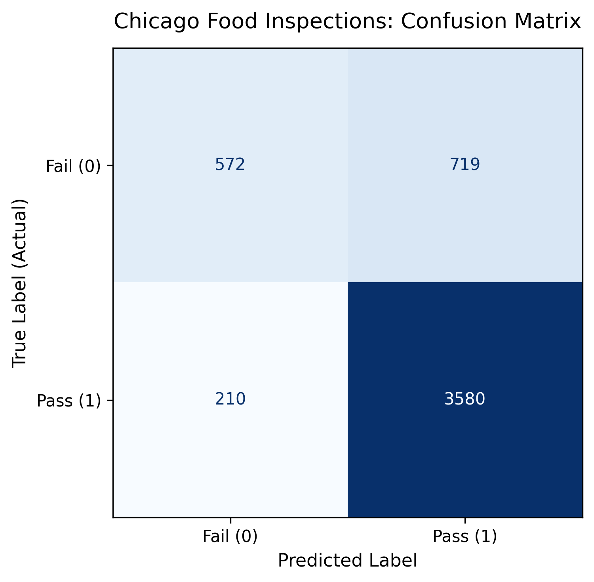

# Chicago Food Inspections - Predictive Risk Modeling

## Overview
Binary classification model built to predict whether a food establishment in Chicago will **Pass** or **Fail** a sanitary inspection based on historical violation records, risk levels, and facility features.

## Key Details
* **Question:** Can we accurately predict sanitary inspection outcomes from historical violation counts and facility attributes?
* **Data:** Official *Chicago Food Inspections* dataset from the Chicago Data Portal ($16,935$ cleaned observations; binary target: `1 = Pass`, `0 = Fail`).
* **Method:** L2-regularized Logistic Regression (`scikit-learn`) with feature engineering (`num_violations`, `has_critical`), one-hot encoding, and stratified 70/30 train-test splitting with `StandardScaler`.
* **Main Result:** Achieved **81.72%** test accuracy at optimal $C=1$. Total violation count proved to be the strongest predictor, reducing passing odds by ~79% per standard deviation.
* **What I Learned:** How class imbalance ($74.6\% / 25.4\%$) affects false positives in regulatory domains and how L2 regularization stabilizes model coefficients.

---

## Model Evaluation & Visualization
Below is the confusion matrix illustrating the performance of the full logistic regression model on the test dataset ($30\%$ holdout).

## Files in this Repository
* `chicago.ipynb` - Complete reproducible analysis, preprocessing, modeling, and evaluation notebook.
* `confusion_matrix.png` - Visual evaluation of test set predictions with labeled axes.
